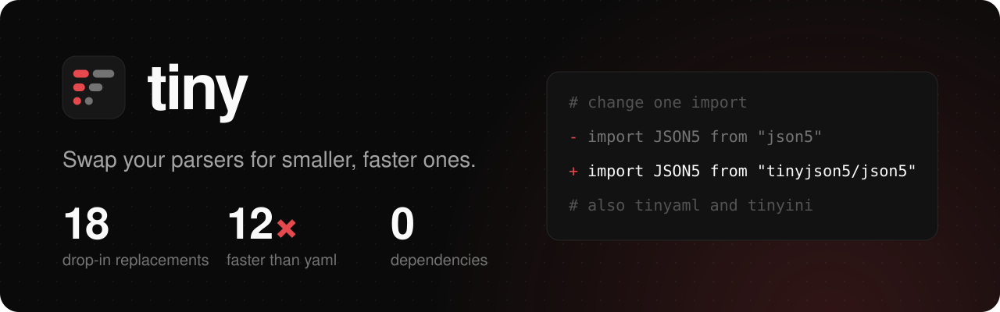

<h1>
  
</h1>

<!-- automd:comark-badges packages=tinyaml,tinyjson5,tinyini,tinylinkify -->

[](https://www.npmjs.com/package/tinyaml)
[](https://www.npmjs.com/package/tinyjson5)
[](https://www.npmjs.com/package/tinyini)
[](https://www.npmjs.com/package/tinylinkify)
[](./LICENSE)
[](https://github.com/onmax/tiny/actions/workflows/release.yaml)

<!-- /automd -->

Smaller, faster, dependency-free parsers and linkifiers you can drop in for the libraries you already use. Change one import and keep your code.

[Packages](#packages) · [Switching](#switching) · [Size and speed](#size-and-speed) · [Docs](https://tiny.onmax.me)

## Packages

| Package                               | Reads and writes |                                 Bundle, gzip | Replaces                                                       |
| ------------------------------------- | ---------------- | -------------------------------------------: | -------------------------------------------------------------- |
| [tinyaml](./packages/tinyaml)         | YAML             | [7.7 KiB](./packages/tinyaml#size-and-speed) | js-yaml 4 and 5, yaml 2, yamljs, @std/yaml                     |
| [tinyjson5](./packages/tinyjson5)     | JSON5            |         [3.4 KiB](./packages/tinyjson5#size) | json5 2.2.3                                                    |
| [tinyini](./packages/tinyini)         | INI              |           [1.3 KiB](./packages/tinyini#size) | ini 1.3.8, 2 to 4.0 and 4.1.3 to 7, @one-ini/wasm 0.1.1 to 0.2 |
| [tinylinkify](./packages/tinylinkify) | Links in text    |       [1.8 KiB](./packages/tinylinkify#size) | linkify-it 4 and 5                                             |

Bundle sizes include every export of each package's root API, minified and gzipped. See [Size and speed](#size-and-speed) for the drop-in replacements.

Each package is published on its own, so install only the ones you use:

```sh
pnpm add tinyaml tinyjson5 tinyini tinylinkify
```

tinylinkify also has `tinylinkify/gfm`, which gives markdown-it and markdown-exit the links remark-gfm and GitHub make, `www.` links included.

## Switching

The quickest way is the codemod. Run it in your project:

```sh
npx tinyswap
```

It finds the libraries you use, picks the tiny subpath that matches each installed version, and asks which ones to migrate. It shows the files it will change, then rewrites the imports and requires, swaps the dependencies in package.json, and offers to run your install. It covers js-yaml, yaml, yamljs, @std/yaml, json5, strip-json-comments, jsonc-parser, comment-json, jju, ini, @one-ini/wasm and linkify-it. `pnpm dlx tinyswap` and `bunx tinyswap` work too, and you can pass a directory, which defaults to the current one.

It won't write to a project outside git or with uncommitted changes unless you pass `--force`. `--yes` migrates everything it finds without asking, `--dry-run` prints the diff and writes nothing, `--only js-yaml,json5` limits it to those libraries, and `--help` lists the flags.

To switch by hand, change the import. The calls, options, output and errors stay the same.

```diff
- import yaml from "js-yaml";
+ import yaml from "tinyaml/js-yaml";

- import JSON5 from "json5";
+ import JSON5 from "tinyjson5/json5";

- import ini from "ini";
+ import ini from "tinyini/ini";

- import LinkifyIt from "linkify-it";
+ import LinkifyIt from "tinylinkify/linkify-it";
```

Each package matches its original on that library's own tests and on tens of thousands to millions of fuzzed inputs, and lists every place it still differs.

## Size and speed

<!-- automd:drop-ins -->

| You use               | Switch to                          |      Size, gzip |       Parses | Stringifies |
| --------------------- | ---------------------------------- | --------------: | -----------: | ----------: |
| js-yaml 4             | `tinyaml/js-yaml`                  | 14.4 → 11.6 KiB |  1.6× faster | 1.7× faster |
| js-yaml 5             | `tinyaml/js-yaml-v5`               | 17.0 → 16.1 KiB |  1.5× faster | 1.8× faster |
| yaml 2                | `tinyaml/yaml`                     | 29.8 → 16.9 KiB | 12.0× faster | 2.8× faster |
| yamljs                | `tinyaml/yamljs`                   |   8.8 → 8.1 KiB |  5.1× faster | 1.1× faster |
| @std/yaml             | `tinyaml/std`                      | 11.2 → 10.7 KiB |  2.4× faster | 1.6× faster |
| json5 2.2.3           | `tinyjson5/json5`                  |   7.5 → 3.2 KiB |  7.4× faster | 4.7× faster |
| json5 1.0.2           | `tinyjson5/json5-v1`               |   8.3 → 3.3 KiB |  7.1× faster | 5.1× faster |
| strip-json-comments 3 | `tinyjson5/strip-json-comments`    |   0.7 → 0.5 KiB |  3.8× faster |           — |
| strip-json-comments 2 | `tinyjson5/strip-json-comments-v2` |   0.6 → 0.5 KiB |  4.2× faster |           — |
| strip-json-comments 5 | `tinyjson5/strip-json-comments-v5` |   0.6 → 0.6 KiB |  3.6× faster |           — |
| jsonc-parser 3.3.1    | `tinyjson5/jsonc-parser`           |   6.6 → 5.7 KiB |  1.2× faster |           — |
| comment-json 4.6.2    | `tinyjson5/comment-json`           | 35.3 → 18.2 KiB |  1.8× faster | 1.3× faster |
| jju 1.4.0             | `tinyjson5/jju`                    |   9.6 → 9.5 KiB |  1.1× faster | 1.6× faster |
| ini 7.0.0             | `tinyini/ini`                      |   1.6 → 1.5 KiB |  1.8× faster | 2.9× faster |
| ini 2.0.0             | `tinyini/ini-v2`                   |   1.4 → 1.4 KiB |  1.6× faster | 1.6× faster |
| ini 1.3.8             | `tinyini/ini-v1`                   |   1.4 → 1.4 KiB |  1.6× faster | 1.7× faster |
| @one-ini/wasm 0.2.1   | `tinyini/one-ini`                  |  36.0 → 1.7 KiB | 12.4× faster |           — |
| @one-ini/wasm 0.1.1   | `tinyini/one-ini-v0.1`             |  32.3 → 1.7 KiB | 12.1× faster |           — |
| linkify-it 5.0.2      | `tinylinkify/linkify-it`           |   4.1 → 3.8 KiB |  1.1× faster |           — |

For new code, the root `tinyaml` API is 7.7 KiB, 1.9× smaller than js-yaml 4 and 3.9× smaller than yaml 2. It parses 18.7× faster than yaml 2 and stringifies 12.9× faster.

Size is the minified bundle, gzipped. Speed is the median time to parse and stringify each package's large benchmark file. @one-ini/wasm's size adds its .wasm file, gzipped, and its speed is parse_to_uint32array on a 100 KB .editorconfig. strip-json-comments only strips comments, so its time is the time to strip them. linkify-it only finds links, so its time is `match` on 100 KB of text. Measured on Apple M4, Node 26.13.0 (tinyaml, tinyjson5, tinyini) and AMD Ryzen 7 255 w/ Radeon 780M Graphics, Node 24.21.0 (tinylinkify).

<!-- /automd -->

ini is already small, so the tinyini entries that replace it save little and win on speed. Most of linkify-it is the patterns its drop-in keeps, so `tinylinkify/linkify-it` saves 8% and wins most where markdown-it calls it on chat, 1.4× faster; `tinylinkify/gfm` is half its size and up to 3× faster, with GFM's links rather than linkify-it's. Each package's README has the full results and the inputs they come from.

## Develop

A pnpm workspace with Node 26, pnpm 12, and [Vite+](https://viteplus.dev) (`vp`) for formatting, linting, tests and builds.

```sh
pnpm install
pnpm build    # every package
pnpm check    # format, lint and typecheck every package
pnpm test     # every package's tests
pnpm fixtures # download what the comparisons and benchmarks run against
pnpm drop-ins # fetch fixtures, measure every package again into .github/drop-ins.json, then pnpm readme
pnpm readme   # rewrite the badges and drop-in tables in every README with automd
pnpm brand    # redraw the logo, favicons and banners from .github/scripts/brand.ts
```

The logo is the 🤏 emoji as [Noto Emoji](https://github.com/googlefonts/noto-emoji) draws it, under the Apache License 2.0.

All packages share one version and release together.

## License

MIT, by [@onmax](https://github.com/onmax).
