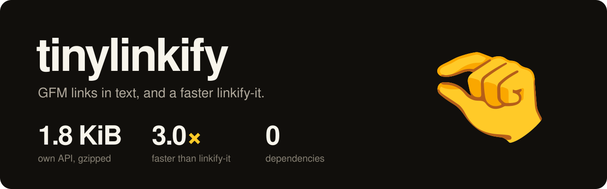

<h1>
  
</h1>

<!-- automd:comark-badges name=tinylinkify size=size -->

[](https://github.com/onmax/tiny/releases)
[](#size)
[](https://www.npmjs.com/package/tinylinkify?activeTab=dependencies)
[](./LICENSE)
[](https://github.com/onmax/tiny/actions/workflows/release.yaml)

<!-- /automd -->

**Links in plain text, in 1.8 KiB.** No dependencies, GFM's autolink rules as remark-gfm and GitHub apply them, and up to 3 times faster than linkify-it.

Already on linkify-it? Change one import and keep your code:

```diff
- import LinkifyIt from "linkify-it";
+ import LinkifyIt from "tinylinkify/linkify-it";
```

tinylinkify ships a drop-in replacement for linkify-it 5 (and 4), and `tinylinkify/gfm`, which gives markdown-it and markdown-exit GFM's links through linkify-it's interface. The drop-in is smaller and faster than linkify-it, passes linkify-it's own tests, and gives the same result on hundreds of thousands of fuzzed inputs, apart from the differences listed under [Switching](#switching-from-linkify-it).

<!-- automd:drop-ins package=tinylinkify -->

| You use          | Switch to                |    Size, gzip |      Parses | Stringifies |
| ---------------- | ------------------------ | ------------: | ----------: | ----------: |
| linkify-it 5.0.2 | `tinylinkify/linkify-it` | 4.1 → 3.8 KiB | 1.1× faster |           — |

The root `tinylinkify` API, which finds GFM links, is 1.8 KiB against 4.1 KiB for linkify-it 5.0.2, and finds them 3.0× faster than linkify-it finds its own in the same text.

Size is the minified bundle, gzipped. Speed is the median time to parse and stringify the large benchmark file. linkify-it only finds links, so its time is `match` on 100 KB of text. Measured on AMD Ryzen 7 255 w/ Radeon 780M Graphics, Node 24.21.0.

<!-- /automd -->

[Get started](#get-started) · [GFM links in markdown-it](#gfm-links-in-markdown-it-and-markdown-exit) · [Switching](#switching-from-linkify-it) · [Size](#size) · [Speed](#speed) · [How it's checked](#how-its-checked) · [npm](https://www.npmjs.com/package/tinylinkify)

An independent project by [@onmax](https://github.com/onmax).

## Get started

```sh
pnpm add tinylinkify
```

npm holds no package under this name until the first release. Until then, clone this repository and run `pnpm install` and `pnpm build` to get the package in `dist/`.

```ts
import { find, test } from "tinylinkify";

find("see www.example.com, or mail a.b@example.com. cc @alice");
// [
//   { schema: "", index: 4, lastIndex: 19, text: "www.example.com", url: "http://www.example.com" },
//   { schema: "mailto:", index: 29, lastIndex: 44, text: "a.b@example.com", url: "mailto:a.b@example.com" },
// ]
test("@alice see you at 10."); // false
```

`find(text)` returns every link in `text`, in order, and `test(text)` whether there is one. A link has the `index` it starts at and the `lastIndex` it ends at, its `text` as written, the `url` it points to, and a `schema`: `""` for a `www.` link, `http:` or `https:`, `mailto:` for an email, or `xmpp:`.

The rules are GitHub's [autolink literals](https://github.github.com/gfm/#autolinks-extension-), as remark-gfm applies them, on text with no other markdown in it:

- `www.` links start at the beginning or after whitespace, `(`, `*`, `_`, `[`, `]` or `~`, and `http://` and `https://` links anywhere but after a letter. A `www.` host needs a dot, and neither host may have an underscore in its last two labels.
- Trailing `?`, `!`, `.`, `,`, `:`, `*`, `_`, `~`, quotes and a character reference such as `&hl;` aren't part of the link, nor is a closing parenthesis it didn't open. `<` ends it.
- An email is letters, digits, `.`, `-`, `_` and `+`, an `@`, then a domain with a dot that ends in a letter. It can't follow a letter, digit, those characters or `/`, so `@mentions` aren't links.
- remark-gfm then searches the text between those links once more, by its own rules, which also link after any punctuation, and `mailto:` and `xmpp:` addresses with a domain the first rules turn down. tinylinkify does both.

Characters are UTF-16 code units, as micromark reads them, so a host can be `例え.テスト` and an emoji doesn't end a path. There are no options: tinylinkify finds what remark-gfm finds.

## GFM links in markdown-it and markdown-exit

markdown-it and markdown-exit find links with linkify-it, which doesn't link `www.example.com` and links fuzzy domains and emails remark-gfm doesn't. `tinylinkify/gfm` is the root's rules behind the methods they call, so their `linkify` option links what GitHub does:

```ts
import MarkdownExit from "markdown-exit";
import LinkifyIt from "tinylinkify/gfm";

const md = MarkdownExit({ linkify: true });
md.linkify = new LinkifyIt();
md.render("see www.example.com, thanks @alice");
// '<p>see <a href="http://www.example.com">www.example.com</a>, thanks @alice</p>\n'
```

It isn't a drop-in for linkify-it, since the links differ. It has `test`, `pretest`, `match` and `matchAtStart`, whose matches have linkify-it's fields, and `set`, which reads `fuzzyLink` (`www.` links) and `fuzzyEmail` (emails without `mailto:`). `tlds` and `add` take their arguments and do nothing, since GFM has no TLD list or custom schemas, and `fuzzyIP` is ignored: GFM links an IP address only after `http://` or `https://`. `pretest` is a quick check that never says no to text with a link: `www.`, `://`, or an address character before an `@`, so chat full of `@mentions` skips `match`.

markdown-it 14 and markdown-exit 1 call `pretest` and then `match`; markdown-it 15 and markdown-exit 2 call `test` and then `match`, and import linkify-it 6's named `LinkifyIt`, which `tinylinkify/gfm` exports too. Its `test` stops at the first link, so a paragraph tested before its text costs little, and `match` keeps the links it found for a `test` of the same text; with markdown-exit 2 it renders 52 chat messages 1.2 times faster than linkify-it 6.1.0 does.

markdown-exit with it links the same as remark-gfm on 98 of 98 chat messages, where linkify-it gets 83 (URLs compared after decoding). The parsers still differ around the linkifier, and tinylinkify/gfm can't change that from inside linkify-it's interface:

- **After an unclosed `[`.** remark-gfm's parser reads no autolink literal after a `[` that hasn't closed yet, and its second search links them by its own rules: it keeps `*`, `_`, `~` and `<` in the link and leaves out `>`, `}` and `&`, needs a dot in the host, and links `mailto:foo@bar.com` with its prefix. markdown-exit asks the linkifier from inside its parser, where the `[` doesn't show, so `[www.commonmark.org/he<lp` links `www.commonmark.org/he<lp` in remark-gfm and `www.commonmark.org/he` in markdown-exit.
- **Character references and escapes.** markdown-exit gives the linkifier the text between them, and links nothing that starts right after one, so `www.a.com&copy;b` links `www.a.com` where remark-gfm links `www.a.com©b`, and `\+a@b.c` links nothing where remark-gfm links `+a@b.c`.
- **Code spans and other inline markup.** markdown-exit parses them before it links `www.` links and emails, and remark-gfm after, so ``www.a.com`]` `` links `www.a.com` in markdown-exit and all of it in remark-gfm. markdown-exit links `http(s)://` first, as remark-gfm does.
- **URLs.** markdown-exit percent-encodes the `href` and writes hosts in punycode, so `https://例え.テスト` points to `https://xn--r8jz45g.xn--zckzah`.

Coming from remark-gfm on its own, the root differs in two places: tinylinkify reads U+0000 as itself, where micromark reads it as U+FFFD, and it doesn't link `ftp://`, which remark-gfm doesn't either, though the GFM spec 0.29 does.

## Switching from linkify-it

`tinylinkify/linkify-it` exports linkify-it's constructor, so switching is a change to the import line. It has linkify-it's instance properties, `re` sources, schemas, options, validators and error messages; the last column is linkify-it's own test suite, run with tinylinkify in its place.

`npx tinyswap` makes this change for you: it rewrites the imports and swaps the dependency in package.json.

| Library               | Change the import to       | Size, gzip      | Its own tests on tinylinkify |
| --------------------- | -------------------------- | --------------- | ---------------------------- |
| linkify-it 4.0.1, 5.x | `"tinylinkify/linkify-it"` | 4.11 → 3.77 KiB | 176 of 176 pass              |

```ts
// before
import LinkifyIt from "linkify-it";
const LinkifyIt = require("linkify-it");
// after
import LinkifyIt from "tinylinkify/linkify-it";
const LinkifyIt = require("tinylinkify/linkify-it");
```

It follows linkify-it 5.0.2. [`scripts/versions.ts`](./scripts/versions.ts) fuzzes linkify-it 3.0.3, 4.0.1, 5.0.0, 5.0.1 and 5.0.2, each against the next: 3.0.3 has no `matchAtStart`, 4.0.1 and 5.0.0 behave the same, 5.0.1 changed how they search, and 5.0.1 and 5.0.2 behave the same. linkify-it 6 is another API, a class with no `pretest` and fuzzy links off by default, and markdown-it 15 and markdown-exit 2 use it; this entry doesn't cover it.

<details>
<summary>linkify-it 5: what's different</summary>

- Unicode punctuation. linkify-it reads it from uc.micro 2.1.0, which has Unicode 15.1; tinylinkify reads the engine's `\p{P}`. On Node 24, which has Unicode 17, 14 more code points are punctuation, so a fuzzy link ends at them where linkify-it reads them as letters: U+1B4E, U+1B4F, U+1B7F, U+10D6E, U+10ED0, U+113D4, U+113D5, U+113D7, U+113D8, U+11BE1, U+16D6D to U+16D6F and U+1E5FF. On another engine, the set is that engine's.
- `re.src_P` holds the same class as uc.micro's `P` for that Unicode version, written with the characters themselves rather than escapes, so the patterns built from it stay well under the 20,480 characters above which V8 stops optimizing a regular expression. linkify-it's fuzzy link pattern is 19,243 characters; tinylinkify's is 11,731. Every other `re` source is linkify-it's, character for character, and they work without the `u` flag as linkify-it's do.
- Start-up. tinylinkify builds that class the first time you construct a linkifier, once per process. On the machine below, importing, constructing and matching once takes 14.2 ms, against 12.4 ms for linkify-it.
- Packaging. ESM only, with a `"module.exports"` export, so `require("tinylinkify/linkify-it")` returns the constructor on Node 22.12 and later, as `require("linkify-it")` does. linkify-it's other files, such as `linkify-it/lib/re.mjs`, have no equivalent, and tinyswap leaves imports of them alone. The types are the signatures of `@types/linkify-it` 5.0.0.
- linkify-it 4.0.1 and 5.0.0. Since 5.0.1, linkify-it searches each pattern on from where its last match ended, so in `<a@b.co:c@d.com>` it finds `a@b.co` and no longer `:c@d.com` too, and since 5.0.2 an email name after `mailto:` is at most 64 characters. linkify-it 4 reads punctuation from uc.micro 1.0.6, which has Unicode 11, 56 code points fewer than 2.1.0.

`match` gets there faster without changing what it finds. It skips the fuzzy link search when the text has no `.` followed by a TLD, which every fuzzy link has; starts the fuzzy email search at most 65 characters before the first `@` that follows a character an email name can end in, since a name is at most 64; and runs each built-in schema's pattern once where linkify-it runs it twice. Each shortcut holds only for the patterns tinylinkify built: one you replace in `re`, or change in `onCompile`, gets linkify-it's way.

</details>

## Size

Each entry as npm ships it in `dist/`, bundled with esbuild, minified ESM, then gzip -9, from [`scripts/size.ts`](./scripts/size.ts). An entry counts its named exports and its default export. A KiB is 1,024 bytes. Measured on Linux with Node 24.21.0.

| Entry                    | Minified  | Gzip     |
| ------------------------ | --------- | -------- |
| `tinylinkify`            | 3.55 KiB  | 1.79 KiB |
| `tinylinkify/gfm`        | 4.65 KiB  | 2.22 KiB |
| `tinylinkify/linkify-it` | 9.94 KiB  | 3.77 KiB |
| linkify-it 5.0.2         | 11.25 KiB | 4.11 KiB |
| linkify-it 6.1.0         | 13.30 KiB | 4.40 KiB |

Most of linkify-it is its patterns, which the drop-in keeps, so it saves what uc.micro's punctuation table weighed, less the code that builds the class and the shortcuts. The GFM entries share one search; `tinylinkify/gfm` adds the interface around it, and is half the size of linkify-it 6.1.0, which markdown-it 15 and markdown-exit 2 use. `scripts/size.ts` fails if an entry outgrows its budget or linkify-it, if one entry bundles another's code, if a package specifier such as `tinylinkify/gfm` loads the wrong entry, or if the root stops being the smallest.

## Speed

Median time per call over seven rounds, from [`bench/index.ts`](./bench/index.ts), on the built `dist/` (AMD Ryzen 7 255, Node 24.21.0, on a machine other jobs share). The two sides' rounds interleave, and which runs first alternates. The inputs are linkify-it's five benchmark samples, 52 chat messages full of `@mentions`, and about 100 KB of all of them; the call is the one markdown-it makes, `match` after a `pretest` that passes. The GFM entries find GFM's links, not linkify-it's, so theirs is the same work on the same text, not the same result. linkify-it 6.1.0 has no `pretest`, so its rows are `test` and then `match`, as markdown-it 15 and markdown-exit 2 call it, each on a new `tinylinkify/gfm`, since it keeps the links of the last text it matched, which a benchmark repeating one text would reuse. linkify-it 6 links no fuzzy domains by default, so on linkify-it's samples, which are mostly those, it does a fraction of the work and is 4 to 8 times faster than `tinylinkify/gfm`; on 100 KB it's 1.3 times faster. The last rows are markdown-exit rendering the chat messages with each linkifier, markdown-exit 2 on its core, where you set the linkifier.

| Library                                         | Operation         |  Library | tinylinkify | Speedup |
| ----------------------------------------------- | ----------------- | -------: | ----------: | ------: |
| linkify-it 5.0.2 → `tinylinkify/linkify-it`     | match chat        | 202.2 µs |    157.5 µs |    1.3x |
|                                                 | match email_fuzzy |  80.7 µs |     67.1 µs |    1.2x |
|                                                 | match link_fuzzy  |  80.7 µs |     66.9 µs |    1.2x |
|                                                 | match link_normal |  86.3 µs |     71.6 µs |    1.2x |
|                                                 | match many        |  70.4 µs |     61.5 µs |    1.1x |
|                                                 | match many_fast   |  69.4 µs |     59.9 µs |    1.2x |
|                                                 | match large       |  5.65 ms |     5.55 ms |    1.0x |
| linkify-it 5.0.2 → `tinylinkify/gfm`            | match chat        | 203.8 µs |     61.8 µs |    3.3x |
|                                                 | match email_fuzzy |  82.5 µs |     62.6 µs |    1.3x |
|                                                 | match link_fuzzy  |  80.6 µs |     61.2 µs |    1.3x |
|                                                 | match link_normal |  86.8 µs |     29.7 µs |    2.9x |
|                                                 | match many        |  69.8 µs |     64.9 µs |    1.1x |
|                                                 | match many_fast   |  69.2 µs |     66.0 µs |    1.0x |
|                                                 | match large       |  5.76 ms |     2.03 ms |    2.8x |
| linkify-it 5.0.2 → `tinylinkify`                | match chat        | 198.6 µs |     61.9 µs |    3.2x |
|                                                 | match large       |  5.99 ms |     2.17 ms |    2.8x |
| linkify-it 6.1.0 → `tinylinkify/gfm`            | test, match chat  |  75.9 µs |     63.8 µs |    1.2x |
|                                                 | test, match large |  1.52 ms |     1.99 ms |    0.8x |
| markdown-exit 1.3.0, linkify-it 5.0.2 → drop-in | render chat       | 343.1 µs |    246.8 µs |    1.4x |
| markdown-exit 1.3.0, linkify-it 5.0.2 → `/gfm`  | render chat       | 345.9 µs |    199.4 µs |    1.7x |
| markdown-exit 2.1.0, linkify-it 6.1.0 → `/gfm`  | render chat       | 230.2 µs |    197.6 µs |    1.2x |

`node bench/index.ts` prints every row, the root's and linkify-it 6's on each sample included.

## How it's checked

The drop-in is checked against linkify-it 5.0.2, and the GFM entries against remark-gfm, each installed next to it as a development dependency:

- linkify-it 5.0.2's own tests, copied unchanged into [`test/suites`](./test/suites) and run with tinylinkify in its place: 172 fixture and API tests, 3 pathological inputs that must not hang, and the CommonJS `require()` test, 176 of 176, as linkify-it passes them.
- 200,000 fuzzed inputs, made by editing linkify-it's fixtures, its benchmark samples and chat with the pieces its patterns care about, through `pretest`, `test`, `match`, `matchAtStart` and `testSchemaAt` on 14 setups: each option, `---`, replaced and added TLDs, added, aliased and disabled schemas, a replaced normalizer and an `onCompile` that changes a template. Arguments of the wrong type, bad schema definitions and odd options are compared too, errors by class and message, and every `re` source after construction. The reference that must match on every input is linkify-it with uc.micro's punctuation swapped for the engine's, built one code point at a time apart from tinylinkify's code: 6,001,500 calls, 0 differences. Against linkify-it as published, the inputs that differ are those with one of the 14 code points above, about 2.3% of them, since the fuzzer adds them on purpose.
- The GFM entries against remark-gfm's autolink step on plain text: micromark with the autolink literal extension and every other construct turned off, then mdast-util-gfm-autolink-literal, so the text is one run as tinylinkify sees it. 69,935 fuzzed lines from the micromark and mdast fixtures, the benchmark samples and chat, with 45,348 links: 0 differences in offsets or URLs, for the root, for `tinylinkify/gfm`'s `match`, and for its `matchAtStart` on each `http(s)://` link, and `test` agrees with whether there's a link.
- The GFM spec 0.29's 11 autolink examples and the fixtures of micromark-extension-gfm-autolink-literal (22) and mdast-util-gfm-autolink-literal (30), whose HTML is what github.com renders, through markdown-exit with tinylinkify/gfm, link for link: it matches remark-gfm on 11, 14 and 15 of them, and GitHub on 10, 3 and 15, where linkify-it matches GitHub on 6, 0 and 1. The fixtures it doesn't match are the markdown cases listed above, mostly `[` before every line; the spec example is `ftp://`.
- Every fuzzer and suite runner exits with an error on a difference or a failed test, and when a suite runs no tests.

## Run the comparisons yourself

```sh
pnpm linkify-it-tests              # linkify-it's own tests against linkify-it and tinylinkify
node scripts/fuzz.ts 20000 1       # the drop-in against linkify-it; the second number is the seed
node scripts/versions.ts 20000     # linkify-it 3.0.3 to 5.0.2, each against the next
node scripts/fuzz-gfm.ts 20000 1   # the GFM entries against remark-gfm on plain text
node scripts/gfm-fixtures.ts       # markdown-exit with tinylinkify/gfm on the GFM fixtures; --all for every case
pnpm size                          # bundle sizes
pnpm bench                         # speed
```

## Develop

tinylinkify is developed with pnpm 12, Node 26 and [Vite+](https://viteplus.dev) (`vp`), which runs oxlint, oxfmt, Vitest and tsdown. [tsrs](https://github.com/oxc-project/tsrs) does the typecheck. On Node, the published package needs version 22.12 or later.

```sh
pnpm install
pnpm ready      # format, build, lint, typecheck and test
pnpm test:dist  # the tests against the built dist/
```

## License

[MIT](./LICENSE). `tinylinkify/linkify-it` follows the behaviour and parts of the code of linkify-it, and the GFM entries copy the rules and patterns of micromark-extension-gfm-autolink-literal and mdast-util-gfm-autolink-literal, so [LICENSE](./LICENSE) also carries their notices. The tests in `test/suites/linkify-it-5.0.2` are linkify-it's, and the fixtures in `test/suites/micromark-*` and `test/suites/mdast-*` are micromark's and mdast's, under the MIT licenses in those folders. `test/suites/gfm-spec-0.29` adapts the GFM spec, under CC BY-SA 4.0.
